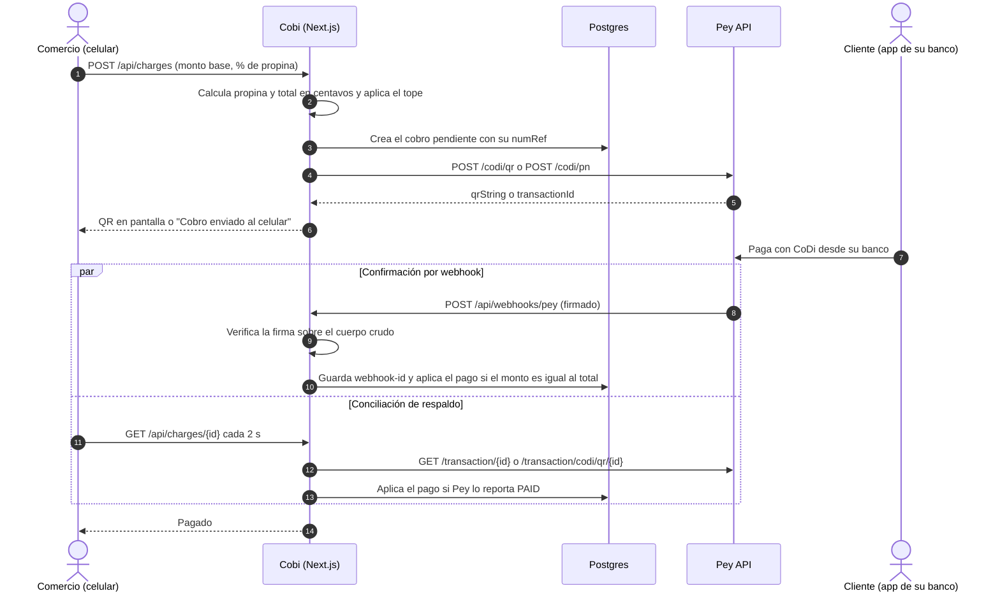
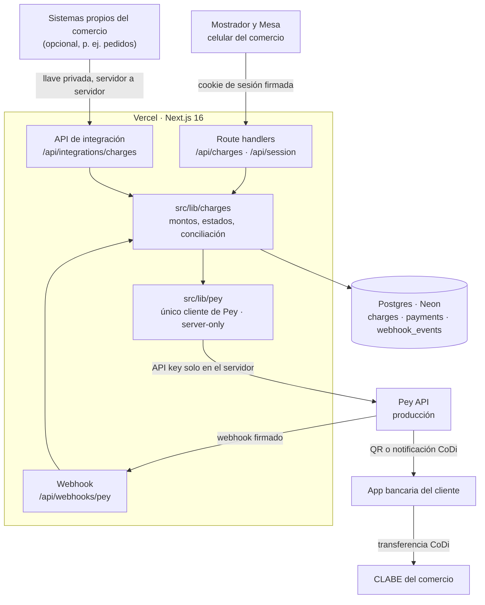

<div align="center">

# 📱 Cobi

### Cobi cobra con CoDi por ti.

Para quien vende por su cuenta y no quiere batallar con las cuentas: personas mayores, puestos y fondas.<br>
**Cobi suma, cobra y confirma por ti.** El cliente paga desde la app de su banco<br>
y tu pantalla dice **"Pagado"** solo cuando el dinero de verdad llegó.

[](https://docs.pey.mx)
[](https://docs.pey.mx)
[](https://code-pay-ochre.vercel.app)
[](https://nextjs.org)

**[▶️ Probar la demo](https://code-pay-ochre.vercel.app)** · **[🧭 Cómo funciona](#-cómo-funciona-en-3-pasos)** · **[🧑‍⚖️ Para el jurado técnico](#-para-el-jurado-técnico)**

</div>

<!-- screenshots -->

---

## 💛 El problema que nos importa

Muchas personas mayores en México siguen trabajando por su cuenta: venden comida, dulces o artesanías. Y cobrar se ha vuelto la parte más difícil del día:

- 🧮 **Hacer cuentas cuesta.** Sumar un pedido, calcular la propina o dar el cambio de cabeza, con gente esperando, termina en errores y en dinero perdido.
- 📸 **No saben si de verdad les pagaron.** Una transferencia se "comprueba" con una captura de pantalla que se falsifica en segundos, y revisar el banco a cada rato no es opción.
- 📱 **La tecnología no está hecha para ellas.** Terminales con renta, apps llenas de menús, registros y letra chiquita.
- 📒 **Las cuentas del día** se quedan en un cuaderno o en la memoria.

Al final se quedan solo con efectivo, pierden ventas o dependen de que alguien más les ayude a cobrar.

**Cobi existe para que cobrar sea tan fácil como hablar:** hace las cuentas, cobra y confirma el pago por ti. Sin trámites para el cliente y sin nada que aprender.

---

## 🌮 Un caso real: Doña Rosa

Doña Rosa tiene 68 años y vende quesadillas afuera del metro. Hacer cuentas de cabeza le cuesta, casi nunca tiene cambio y ya le han enseñado capturas falsas.

**Hoy, con Cobi:**

1. Teclea el monto en un teclado de números grandes, y **Cobi suma la propina y calcula el total** por ella.
2. Le muestra un **código QR** al cliente, que lo escanea con la app de su banco y paga.
3. En segundos, la pantalla dice **✅ Pagado**, en grande y en verde. No tiene que revisar nada.
4. Si una mesa quiere pagar por separado, **Cobi divide la cuenta** y le da a cada quien su QR.

El dinero va **directo de la cuenta del cliente a la de Doña Rosa**. Cobi nunca lo toca.
Y ese "Pagado" no lo puede poner nadie a mano: aparece solo cuando el banco confirmó el pago.

**Lo que viene: Doña Rosa solo le habla a Cobi.**

> 👵 *"Cobi, cóbrale tres quesadillas y un agua."*<br>
> 📱 *"Son 95 pesos. ¿Le muestro el código?"*<br>
> 👵 *"Sí."*<br>
> 📱 *"Ya le pagaron. Hoy lleva 840 pesos."*

Cobi conocerá sus productos y precios, sumará por ella, cobrará y le llevará las cuentas del día.
**El asistente propone, Doña Rosa confirma y solo el banco puede decir "Pagado".**

> [!NOTE]
> Cobrar hablando es la siguiente versión de Cobi. Lo que ya funciona en producción es todo lo de *"Hoy, con Cobi"*:
> cobro con QR o al celular, propina, cuenta dividida y confirmación del banco.

---

## 🧭 Cómo funciona en 3 pasos

| 1️⃣ Teclea | 2️⃣ Muestra o envía | 3️⃣ Cobrado |
|:---:|:---:|:---:|
| El comercio escribe el monto y, si quiere, la propina. | Aparece un QR en pantalla, o el cobro llega como notificación al celular del cliente. | El cliente acepta en su banco y la pantalla cambia a **"Pagado"**, confirmado por el banco. |

El cliente **no descarga nada ni crea ninguna cuenta**: usa la app de su banco, en la opción CoDi.

---

## ✨ Qué puede hacer

| | Para qué sirve |
|---|---|
| 🧾 **Mostrador** | Cobro rápido para cualquier negocio: monto, propina (0, 10, 15, 20 % o la que quieras) y listo. Si el QR vence, se vuelve a generar con un toque. |
| 🍽️ **Dividir la cuenta** | En la mesa, cada persona recibe su propio QR con su parte: partes iguales o montos distintos. La pantalla va contando: *"3 de 4 pagados"*. |
| 🛵 **A domicilio y WhatsApp** | El comercio manda el cobro al celular del cliente y despacha cuando ve "Pagado". O el repartidor enseña el QR en la puerta y ya no carga cambio. |
| 🛡️ **Pagos raros, resueltos** | Si alguien paga tarde, paga dos veces o paga un monto distinto, la app lo detecta y lo marca para revisarlo. No se pierde nada. |

---

## 🏪 Para cualquier comercio

Cobi es el **punto de venta propio de cada comercio**, no un intermediario:

1. **El comercio abre su cuenta en [Pey](https://portal.pey.mx)** y da de alta su CLABE, a su nombre.
2. **Conecta esa cuenta de Pey** a Cobi.
3. **Empieza a cobrar.** Cada peso va directo a su propia CLABE.

> [!NOTE]
> En esta versión del hackatón hay **un solo comercio**: el del equipo, con su propia cuenta de Pey.
> La conexión se configura en el servidor. La pantalla para que cualquier comercio conecte su cuenta es el siguiente paso.

---

## ✅ Pruébalo en 1 minuto

1. Abre **https://code-pay-ochre.vercel.app**. La contraseña de prueba viene en el formulario de entrega del hackatón (no está en este repositorio).
2. **Mostrador:** teclea `0.01`, elige propina y toca **Mostrar QR**. Escanéalo desde la app de tu banco, en la opción CoDi, y mira cómo la pantalla cambia sola a **Pagado**.
3. O escribe tu celular (registrado en CoDi) y toca **Enviar a celular**: te llega la notificación de tu banco.
4. **Dividir cuenta:** escribe el total, el número de personas y elige partes iguales o montos distintos.

> [!IMPORTANT]
> Son **pagos reales** a la cuenta del comercio. Usa montos pequeños; cada cobro tiene un tope.

---

## 🔒 ¿Por qué confiar en el "Pagado"?

- **Lo confirma el banco, no una persona.** Pey avisa a nuestro servidor con un mensaje firmado, y el servidor revisa la firma y que el monto sea exacto antes de marcar el cobro como pagado.
- **Si el aviso se retrasa, igual se entera.** Mientras la pantalla espera, el servidor le pregunta a Pey por el cobro.
- **Nada se cuenta dos veces.** Si llega el mismo aviso dos veces, solo cuenta una.

| Si pasa esto… | …la app hace esto |
|---|---|
| El cliente paga después de que venció el QR | Lo acepta y lo marca como pago tardío. |
| El cliente paga dos veces el mismo cobro | El segundo pago queda apartado para devolverlo a mano. |
| El monto pagado no coincide | El cobro **no** se marca pagado. |
| El aviso del banco no llega | La app consulta a Pey y detecta el pago igual. |

---

## 🗺️ Hacia dónde va Cobi

- 🎙️ **Hablarle a Cobi:** *"cóbrale un pollo y tres quesadillas, con 10 de propina"*, y Cobi arma el cobro con el catálogo del negocio. Pensado para personas mayores y para quien no puede o no quiere hacer cuentas. El asistente propone, la persona confirma y solo el servidor puede decir "Pagado".
- 📒 **Cobi te lleva las cuentas:** *"¿cuánto vendí hoy?"*. Ventas, propinas y pagos por revisar del día, también por voz.
- 🏪 **Empezar sin complicaciones:** cada negocio conecta su propia cuenta de Pey desde la app, guiado paso a paso.

---

## 🧑‍⚖️ Para el jurado técnico

### Cómo usamos la API de Pey

Toda la comunicación con Pey vive en [`src/lib/pey`](src/lib/pey), que es `server-only`: ningún componente del navegador puede importarlo.

| Endpoint / evento | Para qué |
|---|---|
| `POST /codi/qr` | Crea un QR de monto fijo con `numRef` (nuestro "Cobro #1234"), concepto con referencia, vigencia de 360 s y `metadata.chargeId`. Dibujamos el `qrString` en el navegador, sin pedir la imagen a Pey. |
| `POST /codi/pn` | Envía el cobro al celular del cliente. Guardamos `transactionId` y solo los últimos 4 dígitos del teléfono. |
| Webhook `codi.qr.payment_received` | Marca pagado el cobro cuyo `codiQrId` coincide. |
| Webhook `codi.pn.payment_received` | Marca pagado el cobro cuyo `transactionId` coincide. |
| `GET /transaction/{id}` | Concilia cobros push y vuelve a verificar un webhook cuyo monto no coincide (usa `amountBreakdown.base`, para que una comisión al pagador no parezca otro precio). |
| `GET /transaction/codi/qr/{id}` | Concilia cobros QR (con paginación `nextToken`). |

- **Firma del webhook:** Standard Webhooks (`standardwebhooks`) sobre el **cuerpo crudo** (`await req.text()`) antes de parsear. Firma inválida → `401` y no se guarda nada.
- **Idempotencia:** `webhook-id` es la llave primaria de `webhook_events`; `pey_transaction_id` es único en `payments`. Webhook y conciliación aplican el pago en una sola sentencia SQL: solo uno cuenta.
- **Doble verificación:** además de `codiQrId` / `transactionId`, `metadata.externalMetadata.chargeId` debe coincidir con nuestro cobro; si no, el evento se guarda y no se aplica.
- **Conciliación al consultar:** mientras la pantalla consulta un cobro pendiente (cada 2 s), el servidor pregunta a Pey como máximo una vez cada 10 s por cobro, reclamado de forma atómica en la base. No hace falta cron.
- **Montos:** enteros en centavos en la base, el dominio y nuestra API; la conversión a pesos ocurre solo en `src/lib/pey`.
- **Cuenta destino:** no enviamos `bankAccountId`; Pey deposita en la cuenta CoDi ligada a la API key del titular.
- **Aprendido en producción:** el Cobro #1006 se pagó 0.4 s después de nuestro vencimiento; por eso esperamos 60 s de gracia antes de declarar un cobro vencido.

### Flujo de un cobro



### Arquitectura



**API de integración** (`/api/integrations/charges`): para que los sistemas propios del comercio, como su sistema de pedidos, creen y consulten cobros servidor a servidor. Exige `INTEGRATION_API_KEY` en `Authorization`; sin la variable, las rutas responden 404. No es pública ni se ofrece a terceros.

### Seguridad

- **Secretos solo en el servidor:** `PEY_API_KEY` y `PEY_WEBHOOK_SECRET` viven en variables de entorno de Vercel. `src/lib/pey` importa `server-only`, así que el build falla si algo del navegador intenta usarlo. El repo es público y no contiene `.env*` salvo `.env.example` vacío.
- **Sesión del comercio:** cookie `httpOnly`, `Secure`, `SameSite=Lax`, firmada con HMAC-SHA256 y válida 12 h. La contraseña se compara en tiempo constante. Crear y consultar cobros exige sesión.
- **Webhook firmado:** verificación Standard Webhooks sobre el cuerpo crudo, límite de 64 KB y `webhook-id` único.
- **Datos del pagador:** la CLABE, el banco y el tipo de cuenta del pagador se eliminan del payload antes de guardarlo y nunca se escriben en logs. Del teléfono solo quedan los últimos 4 dígitos.
- **Montos calculados en el servidor:** el navegador envía el monto base y el porcentaje de propina, nunca el total. Cada cobro tiene un tope (`DEMO_MAX_AMOUNT_CENTS`) porque la demo mueve dinero real.
- **Solo el servidor marca pagado**, por webhook o conciliación, y solo si lo pagado es igual al total.
- **Cabeceras HTTP:** `frame-ancestors 'none'` y `X-Frame-Options: DENY` contra clickjacking, `nosniff`, `Referrer-Policy` y `Permissions-Policy` mínima. El login solo redirige a rutas del mismo sitio.

### Cumplimiento de las reglas del hackatón

Cobi es el **punto de venta propio del comercio**: cobra a sus propios clientes, hacia su propia cuenta.

| Regla | Cómo la cumplimos |
|---|---|
| **6.2** Cobi real y reacción al resultado | Cada cobro es un QR o un push real creado en Pey; el estado "Pagado" lo pone el webhook firmado (o la conciliación con `GET /transaction`). Nada es simulado. |
| **6.3** Producción | Corre contra la API de producción de Pey. Pagos reales verificados: Cobro #1006 (QR) y #1007 (push), $0.01 cada uno. |
| **6.5 / 9.7** Integración nueva | Todo el repositorio, incluida la integración con Pey, se escribió durante el hackatón; el historial de commits lo muestra. |
| **7.1** Sin cobros a nombre de terceros | Un solo comercio, sus propias ventas. No se juntan pagos de otros negocios. |
| **7.3c** Solo la cuenta del titular | Todo pago, propina incluida, va a la CLABE ligada a la API key del titular. El código nunca envía `bankAccountId`. |
| **7.4** Sin reventa ni exposición de la API | Es un punto de venta propio, el caso que la regla permite. No hay endpoint público para crear cobros: hace falta la sesión del comercio o la llave privada de sus propios sistemas. Cada comercio futuro usará su propia cuenta de Pey. |
| **8.1** Credenciales | La API key y el secreto del webhook solo están en variables de entorno del servidor. Las credenciales de prueba para el jurado van en el formulario de entrega. |

### Declaración de componentes previos

**No hay componentes previos.** Todo el código de este repositorio se escribió durante el hackatón (14 y 15 de noviembre de 2026).
El equipo tiene otros productos, como **Amigapp** y **Celia**, que **no forman parte de esta entrega** ni comparten código con este repositorio.

<details>
<summary><b>🛠️ Correrlo en local</b></summary>

<br>

Requisitos: Node 20 o superior, pnpm 9, una base Postgres (por ejemplo Neon) y una API key de Pey.

```bash
pnpm install
cp .env.example .env.local   # llena los valores
pnpm db:push                 # crea las tablas en Postgres (lee .env.local)
pnpm dev                     # http://localhost:3000
```

| Variable | Qué es |
|---|---|
| `PEY_API_KEY` | API key de Pey. La cuenta CoDi ligada a la key en el portal recibe los pagos. |
| `PEY_WEBHOOK_SECRET` | Secreto de firma del webhook (portal de Pey → Developers). |
| `DATABASE_URL` | Cadena de conexión de Postgres. |
| `MERCHANT_PASSWORD` | Contraseña del comercio. Usa un valor aleatorio largo, p. ej. `openssl rand -base64 32`. |
| `SESSION_SECRET` | Llave para firmar la cookie de sesión. Otro valor aleatorio largo. |
| `DEMO_MAX_AMOUNT_CENTS` | Tope por cobro en centavos (por defecto `1000` = $10.00). |
| `INTEGRATION_API_KEY` | Llave privada para los sistemas propios del comercio. Vacía = API de integración desactivada. |

El webhook se registra en el portal de Pey apuntando a `https://<tu-dominio>/api/webhooks/pey`. En local, sin URL pública, la conciliación detecta los pagos de todos modos.

Verificación: `pnpm lint` · `pnpm typecheck` · `pnpm test` · `pnpm build`.

</details>

<details>
<summary><b>📂 Stack y estructura</b></summary>

<br>

Next.js 16 (App Router) · TypeScript · Tailwind CSS + shadcn/ui · Postgres (Neon) + Drizzle · Vercel · pnpm · Vitest

```
src/
├── app/
│   ├── (merchant)/mostrador   Mostrador
│   ├── (merchant)/mesa        Mesa con cuenta dividida
│   ├── login                  Acceso del comercio
│   └── api/                   Handlers delgados: validan → llaman a lib → responden
│       ├── charges            Crear y consultar cobros
│       ├── integrations       API privada para los sistemas propios del comercio
│       ├── session            Iniciar y cerrar sesión
│       └── webhooks/pey       Webhook firmado de Pey
├── lib/
│   ├── pey/                   Único cliente HTTP de Pey (server-only)
│   ├── charges/               Dominio: crear cobro, aplicar pago, conciliar, estados
│   ├── auth/                  Cookie de sesión firmada y llave de integración
│   └── money.ts               Centavos, propina, división de cuentas
├── components/                UI de Mostrador y Mesa (shadcn/ui)
└── db/                        Esquema Drizzle: charges, payments, webhook_events
```

Más detalle en [`docs/domain.md`](docs/domain.md) (estados y contrato de la API), [`docs/pey-api.md`](docs/pey-api.md) (lo que verificamos de la API de Pey) y [`docs/hackathon-rules.md`](docs/hackathon-rules.md) (las reglas que dan forma al producto).

</details>

---

<div align="center">

Hecho durante el **Hackatón México 2026** sobre la API de [Pey](https://docs.pey.mx).

<sub>CoDi® es una marca de Banco de México. Cobi es un producto independiente y no está afiliado a Banco de México.</sub>

</div>
