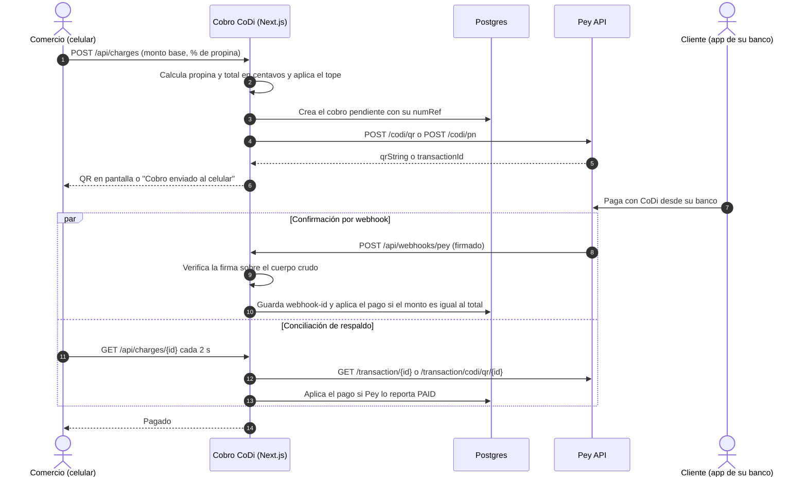
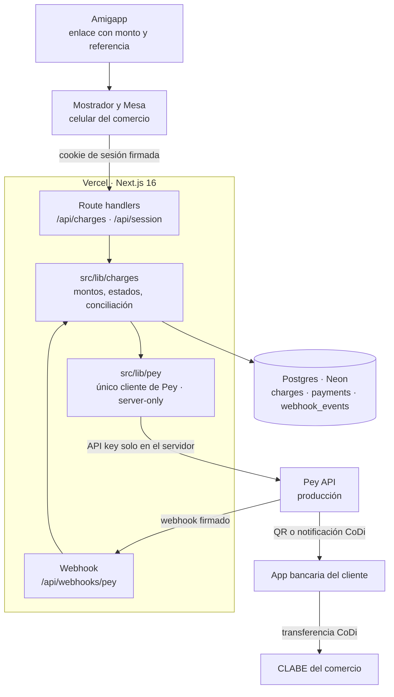

# Cobro CoDi

**El celular del comercio se vuelve su punto de venta CoDi: el cliente paga desde la app de su banco y la pantalla
cambia a "Pagado" en segundos, confirmado por Pey, no por una captura de pantalla.**

Construido durante Hackatón México 2026 sobre la API de [Pey](https://docs.pey.mx).
Demo en vivo: **https://code-pay-ochre.vercel.app**

---

## El problema

| Hoy | Con Cobro CoDi |
|---|---|
| El pequeño comercio vive del efectivo y de "comprobantes" en captura de pantalla, fáciles de falsificar. | El pago se confirma con un webhook firmado de Pey y la clave de rastreo de Banxico. Nadie tiene que revisar una captura. |
| Una terminal de tarjetas cuesta equipo, renta y comisiones. | Basta el celular del comercio. El cliente paga con la app de su banco; no instala nada. |
| Dividir la cuenta en la mesa es un caos de cálculos y transferencias. | Un QR CoDi por persona, con su monto exacto, y un contador en vivo: "3 de 4 pagados". |

El dinero va **directo del banco del cliente a la CLABE del comercio**. Cobro CoDi nunca recibe ni guarda fondos.

## Quién lo usa y cómo

| Persona | Qué hace |
|---|---|
| **Comercio** (cajero, mesero, repartidor) | Abre Cobro CoDi en su celular, teclea el monto, elige propina y muestra un QR o envía el cobro al celular del cliente. |
| **Cliente / comensal** | Escanea el QR o acepta la notificación desde la app de su banco (CoDi). No descarga nada ni crea cuenta. |
| **Restaurantes con Amigapp** | Desde un pedido abren el mostrador ya con el monto y la referencia: `/mostrador?monto=<centavos>&ref=<referencia>`. |

## Funcionalidades

### Mostrador (`/mostrador`)
- Teclado numérico grande; el monto se captura en centavos, sin errores de redondeo.
- Propina de 0, 10, 15, 20 % o cualquier porcentaje de 0 a 100.
- **QR en pantalla** (`POST /codi/qr`) o **cobro al celular** del cliente (`POST /codi/pn`).
- Estado en vivo: pendiente con cuenta regresiva → **Pagado** en verde, con número de cobro y propina incluida.
- Si vence, "Reintentar" crea un cobro nuevo con los mismos datos.

### Mesa (`/mesa`)
- Total de la cuenta, de 2 a 10 personas, **partes iguales** o **montos distintos** por persona
  (valida que las partes sumen el total; los centavos sobrantes se reparten sin perder ninguno).
- Un QR CoDi por persona con la referencia en el concepto del banco (`Mesa 5 2/4`).
- Avance en vivo "x de n pagados"; al pagar una persona, la pantalla pasa a la siguiente para ir pasando el celular.
- Si un QR vence, se genera otro solo para esa persona.

### Casos de uso de reparto
- **Pedido por WhatsApp**: el comercio envía el cobro al celular del cliente y despacha cuando ve "Pagado".
- **Pago contra entrega**: el repartidor muestra el QR en la puerta; ya no carga cambio ni recibe capturas.

### Pagos tardíos, dobles o incompletos
| Situación | Qué pasa |
|---|---|
| El pago llega después del vencimiento | Se acepta y el cobro queda marcado como tardío (`late`). |
| Llega un segundo pago al mismo cobro | Se registra como `excess` para reembolso manual; el cobro no cambia. |
| El monto pagado no coincide con el total | Se registra como `mismatch` y el cobro **no** se marca pagado. |
| Pey reenvía el mismo webhook | `webhook-id` es único en la base: el reenvío no hace nada. |
| Webhook y conciliación llegan al mismo tiempo | Se aplica en una sola sentencia SQL y `pey_transaction_id` es único: solo uno cuenta. |
| El webhook se retrasa o no llega | La conciliación al consultar el estado detecta el pago igual. |

## Cómo usamos la API de Pey

Toda la comunicación con Pey vive en [`src/lib/pey`](src/lib/pey), que es `server-only`: ningún componente del
navegador puede importarlo.

| Endpoint / evento | Para qué |
|---|---|
| `POST /codi/qr` | Crea un QR de monto fijo con `numRef` (nuestro "Cobro #1234"), concepto con referencia, vigencia de 360 s y `metadata.chargeId`. Dibujamos el `qrString` en el navegador, sin pedir la imagen a Pey (respuesta más rápida). |
| `POST /codi/pn` | Envía el cobro al celular del cliente. Guardamos `transactionId` y solo los últimos 4 dígitos del teléfono. |
| Webhook `codi.qr.payment_received` | Marca pagado el cobro cuyo `codiQrId` coincide. |
| Webhook `codi.pn.payment_received` | Marca pagado el cobro cuyo `transactionId` coincide. |
| `GET /transaction/{id}` | Concilia cobros push y vuelve a verificar un webhook cuyo monto no coincide (usa `amountBreakdown.base`, para que una comisión al pagador no parezca otro precio). |
| `GET /transaction/codi/qr/{id}` | Concilia cobros QR (con paginación `nextToken`). |

Detalles de la integración:
- **Firma del webhook**: se verifica con Standard Webhooks (`standardwebhooks`) sobre el **cuerpo crudo**
  (`await req.text()`) antes de parsear. Firma inválida → `401` y no se guarda nada.
- **Idempotencia**: `webhook-id` es la llave primaria de `webhook_events`; `pey_transaction_id` es único en `payments`.
- **Doble verificación**: además de `codiQrId` / `transactionId`, `metadata.externalMetadata.chargeId` debe coincidir
  con nuestro cobro; si no, el evento se guarda y no se aplica.
- **Conciliación al consultar**: mientras la pantalla consulta un cobro pendiente (cada 2 s), el servidor pregunta a
  Pey como máximo una vez cada 10 s por cobro, reclamado de forma atómica en la base. No hace falta cron.
- **Montos**: enteros en centavos en la base, el dominio y nuestra API; la conversión a pesos ocurre solo en
  `src/lib/pey`.
- **Cuenta destino**: no enviamos `bankAccountId`; Pey deposita en la cuenta CoDi ligada a la API key del titular.
- **Errores**: se registran el `type` y el `requestId` de Pey, nunca el cuerpo de la petición ni el teléfono.
- **Aprendido en producción**: el Cobro #1006 se pagó 0.4 s después de nuestro vencimiento; por eso esperamos
  60 s de gracia antes de declarar un cobro vencido.

### Flujo de un cobro



### Arquitectura



## Seguridad

- **Secretos solo en el servidor**: `PEY_API_KEY` y `PEY_WEBHOOK_SECRET` viven en variables de entorno de Vercel.
  `src/lib/pey` importa `server-only`, así que el build falla si algo del navegador intenta usarlo.
  El repo es público y no contiene `.env*` salvo `.env.example` vacío.
- **Sesión del comercio**: cookie `httpOnly`, `Secure`, `SameSite=Lax`, firmada con HMAC-SHA256 y válida 12 h.
  La contraseña se compara en tiempo constante. Crear y consultar cobros exige sesión.
- **Webhook firmado**: verificación Standard Webhooks sobre el cuerpo crudo, límite de 64 KB y `webhook-id` único.
- **Datos del pagador**: la CLABE, el banco y el tipo de cuenta del pagador se eliminan del payload antes de
  guardarlo y nunca se escriben en logs.
- **Teléfonos**: el número completo se envía a Pey una sola vez; en la base solo quedan los últimos 4 dígitos.
- **Montos calculados en el servidor**: el navegador envía el monto base y el porcentaje de propina, nunca el total.
  Cada cobro tiene un tope (`DEMO_MAX_AMOUNT_CENTS`) porque la demo mueve dinero real.
- **Solo el servidor marca pagado**, por webhook o conciliación, y solo si lo pagado es igual al total.
- **Cabeceras HTTP**: `frame-ancestors 'none'` y `X-Frame-Options: DENY` contra clickjacking, `nosniff`,
  `Referrer-Policy` y `Permissions-Policy` mínima. El login solo redirige a rutas del mismo sitio.

## Cumplimiento de las reglas del hackatón

Cobro CoDi es el **punto de venta propio del comercio**: cobra a sus propios clientes, hacia su propia cuenta.

| Regla | Cómo la cumplimos |
|---|---|
| **6.2** Cobro CoDi real y reacción por webhook | Cada cobro es un QR o un push real creado en Pey; el estado "Pagado" lo pone el webhook firmado (o la conciliación con `GET /transaction`). Nada es simulado. |
| **6.3** Producción | Corre contra la API de producción de Pey. Pagos reales verificados: Cobro #1006 (QR) y #1007 (push), $0.01 cada uno. |
| **6.5 / 9.7** Integración hecha en el hackatón | Todo el repositorio, incluida la integración con Pey, se escribió durante el hackatón; el historial de commits lo muestra. |
| **9.2 / 10.1.5** Componentes previos | No hay componentes previos (ver abajo). |
| **7.1** Sin cobros a nombre de terceros | Un solo comercio, sus propias ventas. No se juntan pagos de otros negocios. |
| **7.3c** Solo la cuenta del titular | Todo pago, propina incluida, va a la CLABE ligada a la API key del titular. El código nunca envía `bankAccountId`. |
| **7.4** Sin reventa ni exposición de la API | No existe un endpoint público para crear cobros: crear un cobro exige la sesión del comercio. |
| **8.1** Credenciales | La API key y el secreto del webhook solo están en variables de entorno del servidor. Las credenciales de prueba para el jurado van en el formulario de envío, no en el repo. |

### Declaración de componentes previos
Este repositorio no contiene código de proyectos anteriores. **Amigapp** es un producto previo del equipo
(pedidos para restaurantes); solo se conecta con Cobro CoDi mediante un enlace a `/mostrador` con el monto y la
referencia del pedido.

## Pruébalo

1. Abre **https://code-pay-ochre.vercel.app**. La contraseña de prueba viene en el formulario de envío del
   hackatón; no está en este repositorio.
2. **Mostrador**: teclea `0.01`, elige propina y toca **Mostrar QR**. Escanéalo con la app de tu banco en la opción
   CoDi y mira cómo la pantalla cambia a **Pagado**.
3. O escribe tu celular (registrado en CoDi) y toca **Enviar a celular**: te llega la notificación de tu banco.
4. **Mesa** ("Dividir cuenta"): captura el total, el número de personas y elige partes iguales o montos distintos.
5. **Enlace de Amigapp**: abre `/mostrador?monto=1&ref=PED-123` y el mostrador aparece con $0.01 y la referencia
   `PED-123` (`monto` va en centavos).

> Son pagos reales a la cuenta del comercio. Usa montos pequeños; cada cobro tiene un tope.

## Correrlo en local

Requisitos: Node 20 o superior, pnpm 9, una base Postgres (por ejemplo Neon) y una API key de Pey.

```bash
pnpm install
cp .env.example .env.local   # llena los valores
pnpm db:push                 # crea las tablas en Postgres (lee .env.local)
pnpm dev                     # http://localhost:3000
```

| Variable | Qué es |
|---|---|
| `PEY_API_KEY` | API key de Pey. La cuenta CoDi ligada a la key en el portal recibe los pagos. |
| `PEY_WEBHOOK_SECRET` | Secreto de firma del webhook (portal de Pey → Developers). |
| `DATABASE_URL` | Cadena de conexión de Postgres. |
| `MERCHANT_PASSWORD` | Contraseña del comercio. Usa un valor aleatorio largo, p. ej. `openssl rand -base64 32`. |
| `SESSION_SECRET` | Llave para firmar la cookie de sesión. Otro valor aleatorio largo. |
| `DEMO_MAX_AMOUNT_CENTS` | Tope por cobro en centavos (por defecto `1000` = $10.00). |

El webhook se registra en el portal de Pey apuntando a `https://<tu-dominio>/api/webhooks/pey`. En local, sin URL
pública, la conciliación detecta los pagos de todos modos.

Verificación: `pnpm lint` · `pnpm typecheck` · `pnpm test` · `pnpm build`.

## Stack y estructura

Next.js 16 (App Router) · TypeScript · Tailwind CSS + shadcn/ui · Postgres (Neon) + Drizzle · Vercel · pnpm · Vitest

```
src/
├── app/
│   ├── (merchant)/mostrador   Mostrador
│   ├── (merchant)/mesa        Mesa con cuenta dividida
│   ├── login                  Acceso del comercio
│   └── api/                   Handlers delgados: validan → llaman a lib → responden
│       ├── charges            Crear y consultar cobros
│       ├── session            Iniciar y cerrar sesión
│       └── webhooks/pey       Webhook firmado de Pey
├── lib/
│   ├── pey/                   Único cliente HTTP de Pey (server-only)
│   ├── charges/               Dominio: crear cobro, aplicar pago, conciliar, estados
│   ├── auth/                  Cookie de sesión firmada
│   └── money.ts               Centavos, propina, división de cuentas
├── components/                UI de Mostrador y Mesa (shadcn/ui)
└── db/                        Esquema Drizzle: charges, payments, webhook_events
```

Más detalle en [`docs/domain.md`](docs/domain.md) (estados y contrato de la API) y
[`docs/pey-api.md`](docs/pey-api.md) (lo que verificamos de la API de Pey).

## Siguientes pasos

- **Integración más profunda con Amigapp**: el pedido se marca pagado solo cuando llega el pago CoDi.
- **Panel del comercio**: ventas y propinas del día, cobros tardíos y pagos `excess` / `mismatch` para reembolso.
- **Cada comercio con su propia cuenta de Pey**: su API key y su CLABE, para que el dinero de cada negocio vaya
  siempre directo a su cuenta.
